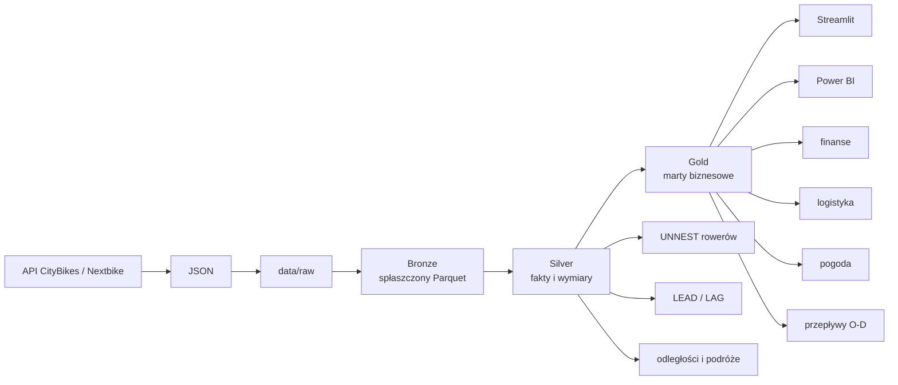

# Veturilo: od danych z API do analizy ruchu

Projekt pokazuje kompletny, lokalny pipeline analityczny dla systemu rowerów miejskich Veturilo w Warszawie. Minutowe zrzuty danych z API CityBikes/Nextbike są przekształcane w DuckDB i dbt do plików Parquet, a następnie prezentowane w aplikacji Streamlit.

Projekt odpowiada na pytania:

- gdzie znajdują się stacje i jak wygląda ich ruch,
- skąd i dokąd najczęściej jadą rowery,
- które stacje wymagają uwagi operacyjnej,
- jak pogoda wpływa na popyt,
- jak zmiana cennika może wpłynąć na przychody.

Całość działa lokalnie, bez serwera bazodanowego i bez chmury.

## Architektura



### Technologie

- **Python**: pobieranie danych i aplikacja Streamlit,
- **DuckDB**: lokalny silnik analityczny do JSON, SQL i Parquet,
- **dbt + dbt-duckdb**: zależności między modelami, transformacje i materializacje,
- **Parquet**: wydajny kolumnowy format danych,
- **Streamlit, Folium i Plotly**: mapa, wykresy i interakcje,
- **Power BI**: opcjonalna warstwa raportowa.

## Wymagania

### Sprzęt i system

- Windows 10/11, Linux lub macOS,
- co najmniej 8 GB RAM do małego wycinka danych,
- około 20 GB wolnego miejsca przy większym zbiorze; profil dbt dopuszcza do 18 GB RAM i 50 GB miejsca tymczasowego,
- połączenie z internetem, jeśli dane mają być pobierane z API.

Pełny zbiór minutowych obserwacji może być duży. Po rozwinięciu tablic `bike_uids` liczba rekordów rośnie wielokrotnie, dlatego do dużych przebiegów warto używać komputera z większą ilością RAM.

### Narzędzia

Wymagane:

- Git,
- Python 3.13 lub nowszy,
- `uv`,
- `dbt-core` z adapterem `dbt-duckdb`,
- DuckDB CLI jest opcjonalny, ale przydatny podczas eksploracji.

Na Windowsie skrypty `.sh` najwygodniej uruchamiać w WSL2. Nie jest to potrzebne do samej aplikacji Streamlit, ale ułatwia wykonanie całego procesu ingestion + dbt.

## Instalacja krok po kroku

### 1. Pobierz repozytorium

```bash
git clone <URL_REPOZYTORIUM>
cd veturilo-project
```

### 2. Zainstaluj WSL2 na Windowsie, jeśli chcesz używać skryptów Bash

W PowerShell uruchomionym jako administratorze:

```powershell
wsl --install -d Ubuntu
```

Po restarcie uruchom Ubuntu:

```powershell
wsl -d Ubuntu
```

Na Linuxie lub macOS ten krok pomiń.

### 3. Zainstaluj `uv`

Windows PowerShell:

```powershell
powershell -ExecutionPolicy ByPass -c "irm https://astral.sh/uv/install.ps1 | iex"
```

Linux/macOS:

```bash
curl -LsSf https://astral.sh/uv/install.sh | sh
```

Sprawdź instalację:

```bash
uv --version
```

### 4. Zainstaluj dbt z adapterem DuckDB

```bash
uv tool install dbt-core --with dbt-duckdb
```

Sprawdź instalację:

```bash
dbt --version
```

Jeśli polecenie `dbt` nie jest widoczne, zamknij i otwórz ponownie terminal albo dodaj katalog narzędzi `uv` do `PATH`.

### 5. Zainstaluj zależności aplikacji

Przejdź do katalogu aplikacji:

```bash
cd streamlit-app
uv sync
```

`uv sync` utworzy lokalne środowisko `.venv` na podstawie [streamlit-app/pyproject.toml](streamlit-app/pyproject.toml). Zainstalowane zostaną między innymi DuckDB, Pandas, Folium, Plotly, Streamlit i `streamlit-folium`.

## Dane wejściowe

Źródłem jest API CityBikes:

- katalog sieci: <https://api.citybik.es/v2/networks>,
- sieć Veturilo Warszawa: <https://api.citybik.es/v2/networks/veturilo-nextbike-warsaw>.

Przykładowy rekord ma strukturę:

```text
network
└── stations[]
    ├── id, name, latitude, longitude
    ├── timestamp
    ├── free_bikes, empty_slots
    └── extra
        ├── uid, number, slots
        └── bike_uids[]
```

Timestamp z API opisuje czas w UTC. Model Bronze normalizuje go do strefy `Europe/Warsaw`, a następnie wyznacza minutę pomiaru i datę partycji.

Dane wejściowe projektu trafiają do:

```text
dbt-project/data/raw/veturilo/**/*.json
```

### Pobieranie pojedynczego zrzutu

Przykładowe polecenie:

```bash
curl -s \
  "https://api.citybik.es/v2/networks/veturilo-nextbike-warsaw" \
  -o snapshot.json
```

Do regularnego zbierania danych należy zapisywać kolejne pliki JSON z nazwą zawierającą czas, najlepiej w podfolderach dziennych. Pliki surowe zachowujemy, ponieważ są punktem audytu i można z nich odtworzyć dalsze warstwy.

## Projekt dbt

Główny projekt znajduje się w [dbt-project](dbt-project). Zawiera konfigurację DuckDB, modele SQL oraz katalogi wynikowe Parquet.

### Zawartość `dbt-project`

```text
dbt-project/
├── dbt_project.yml       # nazwa projektu, ścieżki modeli i hook startowy
├── profiles.yml          # połączenie dbt z DuckDB
├── validate_jsons.sh     # walidacja plików JSON
├── data/
│   ├── raw/veturilo/     # wejściowe JSON-y
│   ├── bronze/           # oczyszczony zapis z partycjami dt
│   ├── silver/           # fakty i wymiary Silver
│   └── gold/             # marty gotowe dla analityki
├── models/
│   ├── 01_bronze/        # JSON -> płaski Parquet
│   ├── 02_silver/        # fakty, wymiary i rekonstrukcja podróży
│   └── 03_gold/          # agregaty biznesowe
├── logs/                 # logi dbt
└── target/               # manifest, graf i skompilowane modele
```

Katalog `target/` jest artefaktem dbt. Nie edytuje się w nim modeli ręcznie. Źródłem prawdy są pliki w `models/` oraz konfiguracja projektu.

### Warstwa Bronze

Modele w `models/01_bronze/` czytają JSON-y za pomocą DuckDB, rozwijają `network.stations` przez `UNNEST` i zapisują dane do Parquet.

- `bronze_veturilo.sql` zawiera stan stacji, liczbę rowerów, wolne miejsca i tablice `bike_uids`,
- `bronze_weather.sql` przygotowuje dane pogodowe. Uwaga - potrzebujesz pliku `data/raw/weather.parquet` z danymi pogodowymi w odpowiedniej strukturze

### Warstwa Silver

Modele w `models/02_silver/` nadają danym stabilne ziarno:

- `dim_stations` — jeden rekord opisujący stację,
- `fct_station_snapshots` — stan jednej stacji w jednej chwili,
- `fct_bike_snapshots` — obecność jednego roweru na jednej stacji w jednej chwili,
- `fct_bike_trips` — zrekonstruowany przejazd między stacjami,
- `dim_station_distances` — odległości pomiędzy parami stacji,
- `fct_weather_hourly` — warunki pogodowe w ziarnie godzinowym.

`LEAD()` i `LAG()` pozwalają porównać kolejne obserwacje tego samego roweru lub stacji. Zmiana stacji roweru staje się podstawą do odtworzenia przejazdu.

### Warstwa Gold

Modele w `models/03_gold/` odpowiadają bezpośrednio na pytania biznesowe:

| Mart | Co opisuje |
| --- | --- |
| `mart_trips_enriched` | przejazdy, czas, dystans, prędkość, opłaty i symulację taryfy 15-minutowej |
| `mart_station_logistics_hourly` | godzinowe wypożyczenia, zwroty, bilans i rolę operacyjną stacji |
| `mart_station_od_flows_hourly` | przepływy Origin-Destination: skąd, dokąd i kiedy jadą rowery |
| `mart_weather_business_hourly` | zestawienie pogody z popytem, prędkością i przychodami |

W aktualnej wersji aplikacja Streamlit czyta wyłącznie dwa marty Gold:

```text
data/gold/mart_station_logistics_hourly.parquet
data/gold/mart_station_od_flows_hourly.parquet
```

Dlatego przed uruchomieniem aplikacji muszą istnieć przynajmniej te dwa pliki.

## Uruchomienie dbt

Wszystkie poniższe komendy wykonuj z katalogu projektu:

```bash
cd dbt-project

# kontrola konfiguracji i połączenia
DBT_PROFILES_DIR=. dbt debug --profiles-dir=.

# zbudowanie całego grafu Bronze -> Silver -> Gold
DBT_PROFILES_DIR=. dbt run --profiles-dir=.
```

W PowerShell odpowiednik ustawienia zmiennej środowiskowej wygląda tak:

```powershell
cd dbt-project
$env:DBT_PROFILES_DIR = (Get-Location).Path
dbt debug --profiles-dir=.
dbt run --profiles-dir=.
```

Uruchomienie wybranej warstwy:

```bash
dbt run --select 01_bronze.* --profiles-dir=.
dbt run --select 02_silver.* --profiles-dir=.
dbt run --select 03_gold.* --profiles-dir=.
```

Uruchomienie jednego martu wraz z zależnościami:

```bash
dbt run --select +mart_station_od_flows_hourly --profiles-dir=.
```

## Aplikacja Streamlit

Aplikacja znajduje się w [streamlit-app/app.py](streamlit-app/app.py). Jest interfejsem eksploracyjnym zasilanym przez DuckDB i pliki Gold.

### Co znajduje się w aplikacji

1. **Wybór stacji** — lista stacji jest zbudowana z nazw i współrzędnych w `mart_station_od_flows_hourly`.
2. **Mapa stacji** — wybrana stacja jest wyróżniona na tle pozostałych.
3. **Ruch godzinowy** — liniowy wykres wypożyczeń i zwrotów z `mart_station_logistics_hourly`.
4. **Tabela tras O-D** — cele podróży z wybranej stacji, posortowane malejąco po liczbie przejazdów.
5. **Mapa wybranej trasy** — po wybraniu celu mapa pokazuje punkt startowy, punkt końcowy i połączenie między nimi.

Aplikacja nie czyta bezpośrednio danych Raw, Bronze ani Silver. Jej interfejsem są marty Gold, dzięki czemu warstwa wizualna nie musi odtwarzać logiki ETL.

### Uruchomienie

W osobnym terminalu:

```bash
cd streamlit-app
uv sync
uv run streamlit run app.py
```

Streamlit wyświetli adres lokalny, zwykle:

```text
http://localhost:8501
```

Jeśli aplikacja zgłasza błąd `No files found that match ... data/gold/...parquet`, najpierw uruchom dbt i sprawdź, czy w katalogu `dbt-project/data/gold/` są wygenerowane marty.

## Przykładowy przebieg warsztatu

1. Otwórz jeden JSON i zobacz strukturę `network -> stations -> extra.bike_uids`.
2. Odczytaj JSON w DuckDB przez `read_json_auto`.
3. Rozwiń tablicę stacji operacją `UNNEST`.
4. Uruchom Bronze i sprawdź Parquet.
5. Przejdź przez modele Silver i zapytaj, co oznacza jeden wiersz każdego modelu.
6. Pokaż `LEAD`/`LAG` w rekonstrukcji podróży i logistyce stacji.
7. Zbuduj Gold i obejrzyj marty biznesowe.
8. Uruchom Streamlit i wybierz stację.
9. Porównaj ruch godzinowy, tabelę O-D i mapę wybranej trasy.
10. Sformułuj decyzję: gdzie relokować rowery, które trasy są najważniejsze albo jak pogoda wpływa na popyt.

## Eksploracja DuckDB

Przykładowe zapytanie do wygenerowanego martu Gold:

```sql
SELECT
    start_station_name,
    end_station_name,
    SUM(trips_count) AS trips
FROM read_parquet(
    'dbt-project/data/gold/mart_station_od_flows_hourly.parquet'
)
GROUP BY 1, 2
ORDER BY trips DESC
LIMIT 20;
```

Przykładowe podsumowanie logistyki:

```sql
SELECT
    station_uid,
    SUM(outgoing_trips) AS outgoing_trips,
    SUM(incoming_trips) AS incoming_trips,
    SUM(net_balance) AS net_balance
FROM read_parquet(
    'dbt-project/data/gold/mart_station_logistics_hourly.parquet'
)
GROUP BY station_uid
ORDER BY net_balance;
```

## Dokumentacja dbt

Po zbudowaniu modeli można wygenerować dokumentację i graf zależności:

```bash
cd dbt-project
dbt docs generate --profiles-dir=.
dbt docs serve --profiles-dir=. --port 8080
```

W dokumentacji warto sprawdzić lineage od JSON/Bronze do Silver i Gold oraz ziarno poszczególnych modeli.

## Najczęstsze problemy

### Brak plików Gold

Objaw:

```text
IO Error: No files found that match ... data/gold/...parquet
```

Rozwiązanie: umieść JSON-y w `dbt-project/data/raw/veturilo/` i uruchom `dbt run --profiles-dir=.` z katalogu `dbt-project`.

### `dbt` nie widzi `profiles.yml`

Uruchamiaj dbt z `dbt-project` i przekazuj `--profiles-dir=.`.

### Aplikacja nie widzi pakietów Python

Uruchamiaj ją przez środowisko projektu:

```bash
cd streamlit-app
uv sync
uv run streamlit run app.py
```

Nie uruchamiaj `streamlit` z przypadkowego globalnego interpretera, jeśli zależności zostały zainstalowane przez `uv`.

### Za mało pamięci

Zacznij od jednego dnia danych, ogranicz liczbę równoległych wątków dbt i zwiększ zakres dopiero po sprawdzeniu wyników. Największy koszt generuje rozwijanie `bike_uids` i rekonstrukcja podróży.
